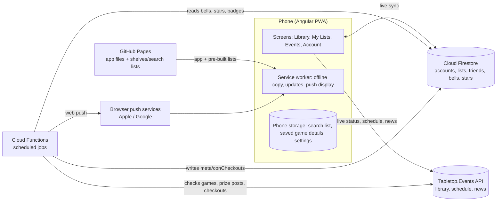

# Architecture

How BGG Library fits together: where data comes from, which code owns what, and how the pieces
talk. Read this before changing something, and use [Tracing a feature end to end](#tracing-a-feature-end-to-end)
when something fails. For setup, deploy and a symptom-first troubleshooting table, see the
[README](README.md).

This document describes things that change rarely. File-level details live in the code comments,
which explain *why* each piece is the way it is.

## Contents

- [Bird's-eye view](#birds-eye-view)
- [Where data comes from](#where-data-comes-from)
- [Code map](#code-map)
- [Data model (Firestore)](#data-model-firestore)
- [Server jobs](#server-jobs)
- [Tracing a feature end to end](#tracing-a-feature-end-to-end)
- [Cross-cutting concerns](#cross-cutting-concerns): [offline](#offline), [Tabletop.Events requests](#tabletopevents-requests),
  [Firestore reads](#firestore-reads-and-connections), [time](#time-and-library-rules), [privacy](#privacy), [UI conventions](#ui-conventions)
- [Rules that must stay true](#rules-that-must-stay-true)
- [Testing approach](#testing-approach)

## Bird's-eye view

The convention library has ~9,000 games. People want to know **what's there, where it is, whether
it's available right now, and what their group wants to play**. The library itself runs on
[Tabletop.Events](https://tabletop.events), which has a public read-only API. This app is a phone
front end over that API plus a small layer of **its own data** (accounts, lists, friends, ratings,
alerts) in Firebase, and **server jobs** for things that must happen while the app is closed
(notifications) or that need a view across the whole library ("Most played this con").



Three sources of truth, never mixed up:

| Truth | Owner | The app's copy |
|---|---|---|
| Which games exist, availability, shelf, condition, schedule | **Tabletop.Events** | Fetched live; short-lived caches only. Never written to Firestore. |
| Who you are, your lists, friends, ratings, bells, starred events, badge number | **Firestore** | Live listeners; Firestore's own offline cache. |
| Search index and shelf lists (names, players, time, shelf) | **`public/shelves/*.json`**, built by `npm run shelves` | Shipped with the app; refreshed by redeploying. |

## Where data comes from

| Data | Source | Fetched by | Cached |
|---|---|---|---|
| Library list pages (browse, sort) | `tabletop.events/api/library/{id}/librarygames` | `service/bgg.service.ts` | Service worker data group, 8 s network timeout, then saved copy |
| One game's live record (status, due, condition notes) | `tabletop.events/api/librarygame/{id}` | `bgg.service.ts` via `shelf.service.ts` (rows on screen), lists, picks | `service/game-details-cache.ts` (2 min fresh, saved on the phone) |
| Search and shelf browsing | `public/shelves/search.json`, `public/shelves/*.json` | `service/local-search.service.ts`, `shelf.service.ts` | Prefetched by the service worker |
| Schedule, rooms, seats left | `tabletop.events/api/convention/{id}/events` … | `service/events.service.ts` | Phone storage + service worker |
| News posts, info pages, Hot Games list | convention `updates` / `pages` | `service/con-info.service.ts`, `util/hot-games.ts` | Phone storage |
| Which convention is current | convention search on Tabletop.Events | `service/convention-sync.ts` → `config/conventions.ts` | Phone storage |
| Lists, friends, ratings, bells, stars | Firestore | `game.service.ts`, `friends.service.ts`, `reactions.service.ts`, `watch.service.ts`, `event-reminders.service.ts` | Firestore offline cache |
| "Most played this con" | `meta/conCheckouts` (written by the server) | `service/con-checkouts.service.ts` | Firestore |

## Code map

"Where's the thing that does X?"

```
src/
  index.html            theme before first paint, scroll-restoration off
  styles.css            design tokens (--bl-*), light + dark, shared row/sheet/chip styles
  app/
    app.component.*     shell: tab bar, toasts, update bar, starts app-wide services
    app.routes.ts       library/home, library/user (My Lists), events, account, login
    app.config.ts       Firebase, service worker registration (registerWhenStable:5000)
    library/            Library tab: list + filters + sort, on-phone search results, shelf browsing
    lists/              My Lists tab: lists, filters, Select mode; hosts Friends' picks and Buy list
    events/             Events tab: schedule, stars, info posts, exhibitors, hours
    account/            Account tab: sign-in state, friends, settings, offline status, version
    shared/             reusable pieces (see below)
    service/            data and app-wide state (see below)
    util/               pure functions: formatting, due times, notes cleaning, Hot Games parsing
    config/             conventions, venue map data, push public key
    model/              TypeScript shapes for Tabletop.Events and Firestore data
functions/index.js      all server jobs
scripts/                build-shelf-index.mjs (search + shelf lists), venue-maps/ (map builder)
public/shelves/         generated search + shelf lists       public/maps/   generated venue map
firestore.rules         who can read/write what        firestore.indexes.json   query index
ngsw-config.json        what the service worker saves for offline use
```

Key services (`src/app/service/`):

| Service | Owns |
|---|---|
| `bgg.service.ts` | Every request to the Tabletop.Events library API |
| `shelf.service.ts` | Shelf lists, and live status for rows as they scroll into view (4 requests at a time) |
| `local-search.service.ts` | On-phone search over `search.json` (instant, offline) |
| `game-details-cache.ts` | Game records shared by My Lists, Friends' picks, Most played; saved on the phone, always re-checked on app open |
| `game.service.ts` / `user.service.ts` / `firestore.service.ts` | Lists (create, add, remove in transactions), profile, Firestore helpers |
| `friends.service.ts` | Meeple codes, requests, friendships, friends' visible lists, Friends' picks aggregation |
| `person-badges.service.ts` | Two-letter initials and a color per friend |
| `reactions.service.ts` | Liked / Not for me / Want to buy |
| `watch.service.ts` + `push.service.ts` | Bells ("tell me when it's back") and the phone's push subscription |
| `event-reminders.service.ts` | Starred events synced to Firestore with a reminder time |
| `prize.service.ts` | Badge number for prize drawings, "You won" |
| `events.service.ts` / `con-info.service.ts` / `convention-sync.ts` | Schedule, news and pages, current convention |
| `con-checkouts.service.ts` | Reads the server's "Most played this con" ranking |
| `firestore-connection.ts` / `network-health.ts` | Reconnect after the app wakes; "Wi-Fi is struggling" detection |
| `app-update.service.ts` / `offline-ready.service.ts` | New-version bar and version line; "Ready offline" status |
| `map.service.ts` | Opening the venue map at a room, booth or the Hot Games tables |

Key shared components (`src/app/shared/`): `sheet` (every pop-up: slide up, swipe down, scroll lock),
`game-sheet` (game details), `friends-picks`, `con-popular`, `notice-tag` (missing-pieces tag),
`person-badge` (friend circle), `play-filters`, `map-viewer`, `update-bar`, `offline-bar`, `toast`.

## Data model (Firestore)

All access is checked by `firestore.rules`; every write lists exactly which fields it may contain.

| Path | Fields | Written by | Read by |
|---|---|---|---|
| `users/{uid}` | uid, email, firstName, lastName, provider | sign-up | the owner |
| `users/{uid}/gameLists/{listId}` | id, name, userId, owner | creating / sharing a list | the holder (it's the key that opens the list) |
| `dataLists/{listId}` | name, gameList[] (id, name, photo, bgg_id, played), owner, visible | anyone holding the list (transactions) | holders; the owner's friends when `visible` |
| `users/{uid}/reactions/{gameId}` | liked, buy, name, photo, at | the owner | owner; friends if `profiles/{uid}.shareRatings` |
| `users/{uid}/watches/{gameId}` | name, shelf, at | the app (bells, automatic for checked-out list games) | owner; server |
| `users/{uid}/eventStars/{eventId}` | name, start, room, remindAt, at | the app | owner; server (collection-group query on `remindAt`) |
| `users/{uid}/pushSubs/{id}` | sub (push endpoint + keys), at | the app after "Turn on" | server |
| `users/{uid}/friends/{other}` | status (outgoing / incoming / friends), name, code, at | both people (request, accept) | both |
| `profiles/{uid}` | name, code, shareRatings | the owner | friends, code lookup |
| `codes/{MEEP-XXXX}` | uid | the owner, once (transaction) | anyone signed in (code lookup) |
| `prizeBadges/{uid}` | badge, notified, at | owner (badge); server (notified) | owner; server |
| `meta/conCheckouts` | top 100 games this con, conId, updatedAt | server only | everyone |
| `meta/watchIndex`, `meta/conCheckoutBaseline`, `meta/conCheckoutState` | server bookkeeping | server only | server only |

## Server jobs

`functions/index.js`, Cloud Functions 2nd gen, region `us-central1`, times in `America/Chicago`.

**`checkWatchedGames`, every 2 minutes**
1. `sendEventReminders`: collection-group query `eventStars where remindAt <= now`; sends a push
   (skipped if the event started more than 5 minutes ago), then clears `remindAt`. Runs at all hours.
2. Library part, paused **2–7 AM Dallas** (nothing moves at the library): reads **one** document,
   `meta/watchIndex`, listing every bell as `uid__gameId`.
3. Finds games that came back: one page sorted by `last_checkin_date` since the last run (cursor in
   memory), plus a direct check of newly added bells. Tabletop.Events requests are free; only
   Firestore reads cost quota.
4. For each game back: reads only those bells, sends a push to each owner's phones, deletes the
   bell (a bell fires once).

**`syncWatchIndex`, on every write to `users/{uid}/watches/{gameId}`**: adds or removes that bell
in `meta/watchIndex`. Rebuilt daily from a collection-group read as a safety net.

**`checkPrizeDrawings`, every 10 minutes** (skipped 2–7 AM and while backing off)
- Reads BGG's news posts for prize-winner lists and alerts people whose `prizeBadges` match;
  clears badge numbers 14 days after the con.
- `trackConCheckouts`: before the library opens, saves each game's all-time checkout count
  (`meta/conCheckoutBaseline`); during the con, reads pages sorted by `last_checkout_date` since the
  last run, adds up checkouts per game (copies combined by BGG id), and writes the top 100 to
  `meta/conCheckouts` only when it changed.

**Shared helpers**: `tteGet` sends a polite User-Agent, times out, and on HTTP 429/503 starts a
10-minute cool-down that every job respects.

Secrets: `VAPID_PRIVATE_KEY` (Firebase secret). The public half is in `src/app/config/push.ts`.

## Tracing a feature end to end

Use these to find where a chain breaks.

**Tap + on a game**
`library.component.ts` `toggleGame` → `game.service.ts` `addGameToList` (Firestore transaction on
`dataLists/{listId}`, skips duplicates) → `dataLists` listener updates My Lists and Friends' picks.
On search rows not yet loaded, `local-results.component.ts` `addTap` fetches the game first (the
list stores its BGG id). *Fails?* Console `permission-denied` = rules; offline = transactions need a
connection (a clear message is shown).

**"Wingspan is back" notification**
List game is checked out → `watch.service.ts` adds `users/{uid}/watches/{gameId}` →
`syncWatchIndex` adds it to `meta/watchIndex` → `checkWatchedGames` sees the game checked in →
reads the bell, sends web push to `users/{uid}/pushSubs/*` → the phone's service worker shows it;
tapping opens My Lists. *Fails?* Check each link in that order: push subscription saved? bell
exists? in `watchIndex`? job logs? (`ngsw-worker.js` shows pushes only when the app was installed to
the Home Screen and notifications allowed.)

**Event reminder**
☆ in Events → `event-reminders.service.ts` writes `eventStars/{id}` with
`remindAt = start − lead` (Account setting; Off = no `remindAt`) → `sendEventReminders` sends at or
after `remindAt` → clears it. Changing the lead re-times every saved star.

**Missing-pieces warning**
Live game record (`missing_components`, `condition_notes`, …) → `util/game-notice.ts` `gameNotice`
(cleans names and staff codes) → `notice-tag` on rows, `.cond` box in `game-sheet`. No extra requests.

**Search**
`library.component.ts` uses `local-search.service.ts` (all words must match) when the phone list has
matches; otherwise falls back to Tabletop.Events' name search. Each visible row fetches live status.

**New version**
Deploy → service worker downloads it in the background → `app-update.service.ts` (checks on open,
on return from background, every 15 min) → update bar → `activateUpdate()`, scroll to top, reload.

## Cross-cutting concerns

### Offline

- `ngsw-config.json` asset groups: **app** (code, prefetch), **maps** (prefetch), **search**
  (`search.json`, prefetch), **assets** and **shelves** (lazy). A data group caches Tabletop.Events
  responses (network first, 8 s timeout, then the saved copy).
- The service worker refuses to serve files whose hash doesn't match `ngsw.json` and silently drops
  to a degraded mode, so deploys must keep files byte-for-byte (the `.gitattributes` step).
  Check `/BGGLibrary/ngsw/state` (`Driver state: NORMAL`).
- `offline-ready.service.ts` counts the prefetch files (except version-named code files) in Cache
  Storage to show "Saving for offline use…" / "Ready offline".
- Firestore keeps its own offline cache, so lists, friends and stars show without a signal; list
  edits use transactions and need a connection.

### Tabletop.Events requests

There's no published rate limit; being blocked would break everyone's app. So:
- Live status only for rows on screen (`in-view.directive.ts`), 4–6 requests at a time.
- Game records reused for 2 minutes; saved on the phone and re-checked once per app open.
- The phone search avoids the slow name search; the server reads one sorted page per run instead
  of polling every game, pauses at night, and cools down after 429/503.

### Firestore reads and connections

Free allowance is 50,000 reads/day; budget for ~10 people is 14–35k. Listeners are kept alive per
session (`keepLive` in `friends.service.ts`) instead of re-subscribing on every tab switch; bells use
one summary document on the server. `firestore-connection.ts` reconnects after the app has been in
the background for a minute (iPhone drops idle connections) and puts a time limit on reads/writes
so buttons don't hang.

### Time and library rules

Everything is in Dallas time (`America/Chicago`). `util/library-time.ts` holds the library's rules:
new games (blue barcode) due in 4 hours, others in 8, midnight–8 AM doesn't count, overnight returns
via the hotel front desk. Convention days and hours come from `config/conventions.ts`, kept current by
`convention-sync.ts`.

### Privacy

- Library staff notes are cleaned before display (`util/game-notice.ts`): names and badge numbers
  removed, internal bookkeeping dropped.
- Ratings are visible to friends only while "Friends can see my ratings" is on; lists only when
  "Friends can see" is on (per list).
- The app only reads public library, schedule and news data from Tabletop.Events, never anything
  about other people's purchases or accounts.

### UI conventions

- Every pop-up uses `shared/sheet.component.ts` (slide up, swipe down to close, page scroll lock,
  focus return).
- Colors are CSS variables in `src/styles.css`, defined twice: light (`:root`) and dark
  (`:root[data-theme="dark"]`). Text meets 4.5:1 and shapes 3:1 contrast in both.
- Bootstrap is loaded app-wide: don't name custom classes `.row`, `.card`, `.mark` and similar, or
  Bootstrap styles leak in.
- Code comments explain *why*, so a reviewer can follow decisions without the chat history.

## Rules that must stay true

- **Never `npm run deploy`** (it publishes to the original repo). Build with `production,fork` from
  PowerShell, add the `.gitattributes` file, check the base href. See the [README](README.md#deploying).
- **Rules before code**: deploy `firestore.rules` before an app version that writes new fields.
- **Tabletop.Events data is never copied into Firestore**; Firestore holds only people's own data
  and the server's small summaries.
- **Lists are changed only in transactions** (`transactUpdate`), so two friends editing a shared
  list can't overwrite each other.
- **A list opens only for people holding a reference** in their own `gameLists` (or friends, when
  the owner made it visible).
- **The push private key never enters the repo.**

## Testing approach

Each feature was checked on the live test site with Playwright driving WebKit in iPhone 15 mode, and
**compared against the source of truth**, not just the screen: shown availability vs Tabletop.Events,
list changes vs Firestore documents, saved files vs Cache Storage, contrast measured from the drawn
colors. Server jobs were tested by writing real test documents (a due reminder, a bell on an
available game) and watching the job handle them.

Lessons learned:
- Reset test accounts before each test (leftover lists and friendships cascade into failures).
- A full page reload in tests logs harmless Firestore "access control" errors; in-app navigation
  doesn't.
- Playwright's Windows WebKit build can crash with several signed-in pages open; rerun or use Edge
  to rule the app out.
- Only a real iPhone can confirm push notifications, Home Screen install, and Airplane Mode reopen.
